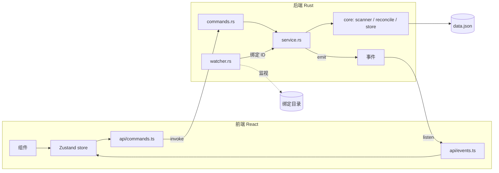

# File Link 开发文档

**对应 PRD：** `docs/PRD.md` v0.2  
**文档版本：** 0.2  
**状态：** 草案  
**日期：** 2026-11-05

---

## 1. 技术栈

| 层 | 选型 | 说明 |
| --- | --- | --- |
| 桌面壳 | Tauri 2 | 使用系统 WebView2，安装包小 |
| 后端核心 | Rust（stable，MSVC 工具链） | 文件扫描、监视、对账、持久化全部在 Rust 侧 |
| 前端 | TypeScript + React + Vite | 只负责展示与交互，不直接碰文件系统 |
| 前端状态 | Zustand | 单一 store 保存后端快照 + 本地 UI 状态 |
| 图标 | lucide-react | 轻量 |
| 长列表 | @tanstack/react-virtual | 链接数量多时虚拟滚动 |
| 包管理 | pnpm | |

### 1.1 Rust 依赖

| crate | 用途 |
| --- | --- |
| `tauri` | 应用框架 |
| `tauri-plugin-dialog` | 系统文件 / 文件夹选择框 |
| `tauri-plugin-opener` | 用默认程序打开文件、在资源管理器中定位 |
| `tauri-plugin-single-instance` | 单实例，避免两个进程同时写数据文件 |
| `notify` + `notify-debouncer-full` | 目录监视（Windows 底层为 `ReadDirectoryChangesW`）与事件防抖 |
| `walkdir` | 递归扫描目录 |
| `dunce` | 路径规范化（去掉 `\\?\` 前缀） |
| `serde` / `serde_json` | 数据序列化 |
| `uuid` | link / binding ID |
| `chrono` | 时间戳 |
| `thiserror` | 错误类型 |
| `log` + `tauri-plugin-log` | 日志；级别 `info`，release 写入应用日志目录 |
| `tempfile`（dev） | 单元测试临时目录 |

### 1.2 前端依赖

`@tauri-apps/api`、`@tauri-apps/plugin-dialog`、`react`、`react-dom`、`zustand`、`lucide-react`、`@tanstack/react-virtual`；开发依赖 `typescript`、`vite`、`vitest`、`eslint`、`prettier`。

---

## 2. 环境准备

1. Node.js 20 LTS 及以上，`npm i -g pnpm`。
2. Rust stable：`rustup default stable-x86_64-pc-windows-msvc`。
3. Visual Studio Build Tools，勾选「使用 C++ 的桌面开发」。
4. WebView2 Runtime（Windows 11 自带；Windows 10 一般已随 Edge 安装）。

初始化与运行：

```powershell
pnpm create tauri-app@latest   # 模板选 React + TypeScript，包管理选 pnpm
pnpm install
pnpm tauri dev                 # 开发运行
pnpm tauri build               # 打包，产物与分发方式见第 12 节
```

应用标识：`com.filelink.app`；窗口标题：`File Link`。

---

## 3. 项目结构

```
file_link/
├─ docs/
│  ├─ PRD.md
│  └─ DEV.md
├─ src/                         # 前端
│  ├─ main.tsx
│  ├─ App.tsx
│  ├─ api/                      # invoke / listen 封装，前端唯一调用后端的入口
│  │  ├─ commands.ts
│  │  └─ events.ts
│  ├─ types.ts                  # 与 Rust 模型对应的 TS 类型
│  ├─ store.ts                  # Zustand store
│  ├─ components/
│  │  ├─ Sidebar.tsx            # 绑定文件夹列表
│  │  ├─ Toolbar.tsx            # 绑定、扫描、设置
│  │  ├─ LinkList.tsx           # 虚拟列表
│  │  ├─ LinkRow.tsx
│  │  ├─ ConfirmDialog.tsx
│  │  ├─ SettingsDialog.tsx     # 文件类型配置
│  │  └─ Toast.tsx
│  ├─ utils/
│  │  └─ filter.ts              # 按绑定过滤与排序
│  └─ styles/
└─ src-tauri/                   # 后端
   ├─ Cargo.toml
   ├─ tauri.conf.json
   ├─ capabilities/default.json
   └─ src/
      ├─ main.rs
      ├─ lib.rs                 # Builder、插件注册、State 管理
      ├─ error.rs               # AppError
      ├─ commands.rs            # #[tauri::command]，只做参数转换和调用 service
      ├─ service.rs             # 业务编排：加锁 → 修改 → 保存 → 发事件
      ├─ core/                  # 不依赖 Tauri，可独立单测
      │  ├─ mod.rs
      │  ├─ model.rs            # Link、Binding、Settings、Ignore、Data
      │  ├─ path.rs             # 路径规范化与去重 key
      │  ├─ rule.rs             # 扩展名匹配、内置忽略目录、临时文件判断
      │  ├─ scanner.rs          # 扫描绑定目录
      │  ├─ reconcile.rs        # 对账算法
      │  └─ store.rs            # JSON 读写、原子写入、版本迁移
      └─ watcher.rs             # 监视管理：每个绑定一个 debouncer
```

**分层约束：**

- `core/` 不引用 `tauri`，所有逻辑可在 `cargo test` 中用临时目录测试。
- `commands.rs` 不写业务逻辑。
- 前端不直接使用 `fs` 类插件，所有文件操作都经由自定义 command。

---

## 4. 架构总览



**核心原则：**

1. **监视事件只作为「需要对账」的信号。** 不逐条信任 create / remove / rename 事件，而是防抖后对整个绑定目录跑一次对账。手动扫描、自动导入、启动补扫共用同一套对账逻辑。
2. **后端是唯一数据源。** 前端收到 `state-changed` 事件后重新拉取快照，不在前端自行推算数据变更。
3. **任何操作都不修改原文件。** 代码中不出现对原文件的写、移动、删除调用。

---

## 5. 数据模型

### 5.1 Rust 结构

```rust
#[derive(Serialize, Deserialize, Clone)]
#[serde(rename_all = "camelCase")]
pub struct Data {
    pub version: u32,                 // 当前为 1
    pub settings: Settings,
    pub bindings: Vec<Binding>,
    pub links: Vec<Link>,
    pub ignored: Vec<Ignore>,
}

#[derive(Serialize, Deserialize, Clone)]
#[serde(rename_all = "camelCase")]
pub struct Settings {
    pub extensions: Vec<String>,      // 小写、带点，默认 [".html", ".htm"]
}

#[derive(Serialize, Deserialize, Clone)]
#[serde(rename_all = "camelCase")]
pub struct Binding {
    pub id: String,
    pub path: String,                 // 显示用路径
    pub key: String,                  // 规范化 key，用于去重
    pub recursive: bool,
    pub auto_watch: bool,
    pub rule_id: Option<String>,      // 预留：None 表示使用全局规则
    pub created_at: DateTime<Local>,
    #[serde(default)]
    pub unavailable: bool,            // 目录本身不存在或无权限
}

#[derive(Serialize, Deserialize, Clone)]
#[serde(rename_all = "camelCase")]
pub struct Link {
    pub id: String,
    pub path: String,
    pub key: String,
    pub name: String,
    pub sources: Vec<Source>,         // 至少一个；为空即删除该 link
    pub added_at: DateTime<Local>,
    #[serde(default)]
    pub missing: bool,
}

#[derive(Serialize, Deserialize, Clone, PartialEq)]
#[serde(tag = "type", rename_all = "camelCase")]
pub enum Source {
    Manual,
    #[serde(rename_all = "camelCase")]
    Binding { binding_id: String },
}

#[derive(Serialize, Deserialize, Clone)]
#[serde(rename_all = "camelCase")]
pub struct Ignore {
    pub binding_id: String,
    pub key: String,
}
```

### 5.2 为什么用 `sources` 集合

同一个文件可能既被手动导入，又落在某个绑定目录里。PRD 要求解除绑定时保留手动导入的 link，因此一条 link 记录它的全部来源：

- 手动导入：加入 `Manual`。
- 绑定扫描命中：加入 `Binding { binding_id }`。
- 解除绑定：从所有 link 中去掉该绑定来源，`sources` 变空的 link 才删除。
- 界面「来源」列：有 `Manual` 显示「手动」，有绑定显示文件夹名，二者都有则都显示。

### 5.3 忽略名单

用户从集合中移除一条带绑定来源的 link 时，为该 link 的每个绑定来源写入一条 `Ignore`。对账时命中忽略名单的文件不会再自动加回。

- 手动导入不受忽略名单影响：用户主动导入被忽略的文件时正常创建 link（来源为 `Manual`），忽略记录保留。
- 解除绑定时同时清除该绑定的忽略记录。

### 5.4 存储

- 位置：`app_data_dir()/data.json`，即 `%APPDATA%\com.filelink.app\data.json`。
- `load(path) -> Result<LoadResult>`：文件不存在返回默认数据；JSON 损坏时把原文件重命名为 `data.json.broken-<时间戳>`，返回默认数据和备份路径。
- `save(path, data)`：必要时创建目录；先写 `data.json.tmp`，`flush` + `sync_all` 后 `rename` 覆盖 `data.json`。
- 每次数据变更后立即保存（数据量小，不做延迟批量写入）。
- `migrate(data)`：按 `version` 逐级迁移；当前版本为 1。
- 读取失败后以空数据启动，并在界面提示用户。

### 5.5 TS 类型

`src/types.ts` 手写与 Rust 对应的类型（字段为 camelCase）。模型稳定后可考虑引入 `tauri-specta` 自动生成。

```ts
export type Source = { type: "manual" } | { type: "binding"; bindingId: string };

export interface Link {
  id: string;
  path: string;
  key: string;
  name: string;
  sources: Source[];
  addedAt: string;
  missing: boolean;
}

export interface Binding {
  id: string;
  path: string;
  key: string;
  recursive: boolean;
  autoWatch: boolean;
  ruleId: string | null;
  createdAt: string;
  unavailable: boolean;
}

export interface Settings {
  extensions: string[];
}

export interface Snapshot {
  settings: Settings;
  bindings: Binding[];
  links: Link[];
}

export interface AppError {
  code: string;
  message: string;
}
```

---

## 6. 核心模块设计

### 6.1 `core/path.rs`：路径规范化

- `normalize(path) -> Result<(display: String, key: String), std::io::Error>`
  - 文件存在时用 `dunce::canonicalize` 得到绝对路径（去掉 `\\?\` 前缀）。
  - 统一分隔符为 `\`，去掉末尾分隔符（盘符根路径 `C:\` 保留）。
  - `key` = `display` 转小写（Windows 路径不区分大小写）。
  - 路径不存在或无法访问时返回错误。
- link 和 binding 的去重一律按 `key` 比较。
- 文件缺失时无法规范化，沿用创建 link 时保存的 `key`。

### 6.2 `core/rule.rs`：规则

- `matches(path, extensions) -> bool`：扩展名不区分大小写比较。
- 内置跳过的目录（递归扫描时不进入）：`node_modules`、`.git`、`$RECYCLE.BIN`、`System Volume Information`。
- 临时文件判断（不导入）：文件名以 `~$` 开头，或扩展名为 `.tmp`、`.crdownload`、`.part`。
- 规则接口按「绑定 → 生效规则」设计：`effective_rule(binding, settings)`。首期始终返回全局规则，后续支持每个绑定独立规则时只改这一处。

### 6.3 `core/scanner.rs`：扫描

- `scan(binding, rule) -> Result<Vec<(display, key)>>`
- 非递归：只读一层；递归：`walkdir`，`filter_entry` 跳过内置忽略目录。
- 遇到单个子目录无权限时记录日志并跳过，不中断整个扫描。
- 绑定目录本身不存在或不可读：返回错误，由上层把 `binding.unavailable` 设为 `true`。

### 6.4 `core/reconcile.rs`：对账

输入为当前 `Data`、一个绑定和扫描结果，原地修改 `Data`，返回 `ReconcileSummary { added, restored, missing }`。

```
files = scan(binding)                        # 规范化后的 key 集合
for f in files:
    if (binding.id, f.key) 在 ignored 中: 跳过
    if 已存在 key == f.key 的 link:
        若 sources 不含该绑定 → 加入该绑定来源
        若 missing == true → 置为 false，restored += 1
    else:
        新建 link，sources = [该绑定]，added += 1

for link in 含该绑定来源的 links:
    if link.key 不在 files 中 且 文件确实不存在:
        若 missing == false → 置为 true，missing += 1
```

规则说明：

- 文件仍存在、只是不再匹配规则（例如用户改了扩展名列表）时，**保留** link，不标记缺失。PRD 只要求新规则作用于之后的扫描。
- 对账只修改带该绑定来源的 link。手动 link 的缺失状态由 6.7 中的「全量状态检查」负责。

### 6.5 `watcher.rs`：目录监视

- `WatcherManager` 持有 `HashMap<binding_id, Debouncer>`。
- 每个 `auto_watch == true` 的绑定对应一个 `notify-debouncer-full` 实例：
  - 防抖窗口 1500ms。
  - `RecursiveMode` 由 `binding.recursive` 决定。
- 收到事件后不解析具体变更，只把 `binding_id` 发送到一个 `mpsc` 通道。
- 后台工作线程从通道取出绑定 ID，在 500ms 内对同一绑定的重复请求做合并，然后调用 `service.reconcile_binding(id)`。
- **写入中的文件：** 对账发现新文件时检查文件大小与修改时间，间隔 500ms 读两次；不一致则本次不建 link，并在 2 秒后为该绑定重新排一次对账。
- **监视出错**（缓冲区溢出、目录被删等）：记录日志，触发该绑定的完整对账；目录不存在时置 `unavailable = true` 并停止监视。
- 绑定的 `auto_watch` 或 `recursive` 修改后，先停掉旧 debouncer 再按新配置重建。
- 网络路径（以 `\\` 开头的 UNC 路径或映射的网络盘）：开启自动导入时在界面提示「网络目录的监视可能不可靠，建议配合手动扫描」。

### 6.6 打开与定位

- 打开：先检查文件是否存在。不存在则把 link 置为 `missing`，返回 `FileMissing` 错误；存在则调用 `app.opener().open_path(path, None::<&str>)`，由系统默认程序打开（HTML 即默认浏览器）。
- 定位：调用 `app.opener().reveal_item_in_dir(path)`，在资源管理器中选中该文件；文件缺失时改为打开其所在目录（若目录存在）。
- 打开失败（无关联程序、无权限）：返回 `OpenFailed`，附系统错误信息。

### 6.7 `service.rs`：业务编排

- 全局状态：`AppState { data: Mutex<Data>, data_path: PathBuf }`，通过 `app.manage()` 注册。`watcher` 在监视里程碑加入。
- 启动时读取 `app_data_dir()/data.json`；不存在则写入默认数据。若发生损坏恢复，在前端首次 `get_snapshot` 时发送 `data-recovered`。
- 每个写操作走 `write_and_emit`：加锁 → 修改 `Data` → 原子保存 → 解锁 → `emit("state-changed")`。修改先作用在副本上，保存成功后再替换内存状态。
- 扫描放在锁外执行，拿到结果后再加锁对账，避免大目录扫描期间阻塞界面上的其他操作。
- **全量状态检查** `refresh_missing()`：遍历所有 link，按文件是否存在更新 `missing`。在启动时和用户点击「扫描新文件（全部）」时执行。

---

## 7. 前后端接口

### 7.1 Commands

所有 command 返回 `Result<T, AppError>`。文件选择框由前端用 `@tauri-apps/plugin-dialog` 打开，拿到路径后再调用对应 command。

| Command | 参数 | 返回 | 说明 |
| --- | --- | --- | --- |
| `get_snapshot` | — | `Snapshot` | 获取全部数据 |
| `import_files` | `paths: string[]` | `{ added, skipped }` | 后端保留以兼容旧数据；界面不再调用 |
| `preview_binding` | `path, recursive` | `{ count }` | 绑定前预扫描，返回命中数量 |
| `add_binding` | `path, recursive, autoWatch` | `{ binding, added }` | 绑定并首次扫描；同一目录已绑定时报错 |
| `update_binding` | `id, recursive?, autoWatch?` | `Binding` | 修改后重建监视；改 `recursive` 后立即对账 |
| `remove_binding` | `id` | `{ removedLinks }` | 解除绑定，规则见 5.2、5.3 |
| `scan_binding` | `id` | `ReconcileSummary` | 扫描单个绑定 |
| `scan_all` | — | `ReconcileSummary` | 扫描全部绑定 + 全量状态检查 |
| `remove_links` | `ids: string[]` | `{ removed }` | 只删 link，按 5.3 写忽略名单 |
| `open_link` | `id` | — | 见 6.6 |
| `reveal_link` | `id` | — | 见 6.6 |
| `update_settings` | `extensions: string[]` | `Settings` | 去空格、转小写、补前导点、去重；规范化后为空则报错 |

### 7.2 Events（后端 → 前端）

| 事件 | 载荷 | 前端处理 |
| --- | --- | --- |
| `state-changed` | — | 重新调用 `get_snapshot` |
| `auto-imported` | `{ bindingId, added }` | Toast：「已从 xxx 自动导入 N 个文件」 |
| `binding-unavailable` | `{ bindingId }` | 侧边栏该绑定显示「目录不可用」 |
| `data-recovered` | `{ backupPath }` | 提示：「数据文件已损坏，已备份到 {backupPath}，当前以空数据启动。」 |

### 7.3 错误

```rust
#[derive(Debug, thiserror::Error)]
pub enum AppError {
    #[error("文件不存在或已被移动，可以从列表中移除该链接")]
    FileMissing,
    #[error("该文件夹已经绑定过了，可以在侧边栏中管理已有绑定")]
    BindingExists,
    #[error("文件夹不存在或无法访问，请确认路径后重新扫描，或解除绑定")]
    BindingUnavailable,
    #[error("无法打开文件，请确认文件仍在原位置，或从列表中移除该链接")]
    OpenFailed(String),
    #[error("找不到对应的记录，请刷新后重试")]
    NotFound,
    #[error("至少需要一个文件类型，请填写后再保存")]
    EmptyExtensions,
    #[error("保存数据失败，请检查磁盘空间和文件权限后重试")]
    Io(#[from] std::io::Error),
}
```

序列化为 `{ code: "FileMissing", message: "文件不存在或已被移动，可以从列表中移除该链接" }`，前端直接展示 `message`。系统错误细节不拼进用户可见文案。

---

## 8. 关键流程

### 8.1 启动

1. `single-instance`：已有实例时激活已有窗口，新进程退出。
2. 读取 `data.json`（不存在则创建默认数据；损坏则按 5.4 处理）。
3. 后台对每个绑定执行一次对账（补齐程序未运行期间的变化），再执行全量状态检查。
4. 为 `auto_watch == true` 的绑定启动监视。
5. 前端挂载后调用 `get_snapshot`，并订阅事件。

首期关闭窗口即退出程序，不常驻托盘。程序未运行期间的变化由第 3 步补齐。

### 8.2 手动导入

界面不再提供手动导入入口。后端仍保留 `import_files`，以兼容已有数据中的 `Manual` 来源；仅手动来源的链接不再出现在列表中。

### 8.3 绑定文件夹

前端打开文件夹选择框 → 弹出绑定选项（是否包含子文件夹、是否自动导入）→ `preview_binding` → 命中数超过 500 时二次确认 → `add_binding` → 首次对账 → 按需启动监视 → `state-changed`。

### 8.4 新文件进入绑定目录

- 自动导入开启：监视事件 → 防抖 → 对账 → 有新增时发 `auto-imported` 和 `state-changed`。
- 自动导入关闭：用户点「扫描新文件」→ `scan_binding` 或 `scan_all`。

### 8.5 移除 link

确认框文案：「从 File Link 中移除选中的 N 个链接？只删除链接，不删除原文件。」→ `remove_links` → 带绑定来源的写入忽略名单 → 删除 link → `state-changed`。

### 8.6 解除绑定

确认框文案：「解除绑定后，将移除由该文件夹自动生成的链接。只删除链接，不删除原文件。」→ `remove_binding` → 停止监视 → 去掉来源、删除空来源 link、清除该绑定的忽略记录 → `state-changed`。

---

## 9. 前端设计

### 9.1 布局

```
┌──────────────┬──────────────────────────────────────────────┐
│ ── 文件夹 ── │ [绑定文件夹] [扫描新文件] [⚙]                │
│  tools  (n)  ├──────────────────────────────────────────────┤
│  report (n)  │ 名称        路径               来源      加入时间   │
│              │ json.html   D:\tools\json.html 文件夹    11-04 15:00 │
│              │ old.html    D:\tools\old.html  文件夹 [缺失]        │
└──────────────┴──────────────────────────────────────────────┘
```

- 侧边栏：各绑定文件夹（显示数量；悬停显示完整路径；右键菜单：扫描、自动导入开关、包含子文件夹开关、在资源管理器中打开、解除绑定）。不提供「全部链接」「手动导入」。
- 工具栏：绑定文件夹、扫描新文件、设置。不提供搜索和「导入文件」。
- 列表：双击或回车打开；右键菜单：打开、在资源管理器中显示、复制路径、移除链接；支持 Ctrl / Shift 多选后批量移除。无绑定时提示「请先绑定文件夹」。
- 缺失的 link 灰显并带「缺失」标签，打开时提示「文件不存在或已被移动，可以从列表中移除该链接」。
- 设置对话框：编辑扩展名列表（逗号分隔），保存时提示「新规则将在之后的扫描中生效」。

### 9.2 状态

```ts
interface UiState {
  snapshot: Snapshot | null;
  view: { type: "binding"; id: string } | { type: "none" };
  selectedIds: Set<string>;
}
```

- 列表数据 = `filter(snapshot.links, view)`，放在 `utils/filter.ts`，纯函数，便于单测。
- 只显示当前选中绑定的链接；无绑定时列表为空。
- 启动或当前绑定被解除后，选中剩余的第一个绑定；一个都没有则为 `none`。
- 列表默认排序：缺失的排在后面，其余按名称排序。

### 9.3 文案原则

- 界面全中文。
- 凡涉及删除，文案必须写明「只删除链接，不删除原文件」。
- 错误提示直接说明原因和用户可做的操作，例如「文件不存在或已被移动，可以从列表中移除该链接」。

---

## 10. 测试

### 10.1 Rust 单元测试（`core/`）

用 `tempfile::TempDir` 构造目录，覆盖：

- `path`：大小写不同、分隔符不同、末尾带分隔符的路径得到相同 key。
- `rule`：扩展名大小写、临时文件、内置忽略目录。
- `scanner`：递归与非递归、子目录无权限时跳过。
- `reconcile`：
  - 新文件被导入；已存在不重复。
  - 被忽略的文件不再加回。
  - 文件删除后标记缺失，恢复后取消缺失。
  - 手动 + 绑定双来源：解除绑定后 link 保留。
  - 修改扩展名后，已有 link 不被删除。
- `store`：原子写入、损坏文件备份恢复、版本迁移。

### 10.2 监视集成测试

`watcher` 的测试依赖真实文件系统事件和时间，标记为 `#[ignore]`，在本地用 `cargo test -- --ignored` 手动运行：创建文件 → 等待约 3 秒 → 断言出现新 link。

### 10.3 前端

`vitest` 测试 `utils/filter.ts`（按绑定过滤、排序）。

### 10.4 手动验收（对应 PRD 第 9 节）

1. 绑定一个含 HTML 的文件夹，关闭资源管理器，从 File Link 打开其中一条链接，默认浏览器显示该页面。
2. 绑定一个含多个 HTML 的文件夹，列表数量与目录中 HTML 数量一致。
3. 自动导入开启时，向该文件夹复制一个新 HTML，数秒内列表出现；关闭自动导入后再复制一个，点「扫描新文件」后出现。
4. 移除一个 link，确认原文件仍在原路径。
5. 检查 `%APPDATA%\com.filelink.app\` 下只有 `data.json` 和日志，没有任何被管理文件的副本。
6. 移除一个文件夹来源的 link 后再扫描，该 link 不会回来。
7. 在资源管理器中删除一个已收录的文件，列表中对应 link 显示「缺失」。

---

## 11. 里程碑

各里程碑拆分后的任务、依赖与进度见 `docs/PLAN.md`。

| 里程碑 | 内容 | 完成标准 |
| --- | --- | --- |
| M1 骨架 | Tauri 项目初始化、`core/model` `path` `store`、手动导入、列表、打开、定位、移除 | 验收 1、4、5 通过 |
| M2 绑定 | `rule` `scanner` `reconcile`、绑定 / 解除绑定、预扫描确认、忽略名单、侧边栏视图 | 验收 2、6 通过 |
| M3 监视 | `watcher`、防抖与写入稳定检查、启动补扫、全量状态检查、缺失标记、自动导入提示 | 验收 3、7 通过 |
| M4 打磨 | 设置对话框、错误与确认文案、多选批量操作、长列表虚拟滚动、日志、应用图标、release 配置、精简浏览入口 | 全部验收通过，`core` 单测全绿，免安装版 exe 在干净的 Windows 10/11 上能运行 |
| M5 分发（MVP 之后） | NSIS 安装程序、WebView2 引导安装、代码签名 | 安装、启动、卸载流程走通，卸载后原文件不受影响 |

---

## 12. 打包与分发

用户拿到的是 Windows 原生 `.exe`，不需要安装 Node.js 或任何 npm 包。pnpm 只在开发和构建时使用。

### 12.1 产物形式

| 形式 | 构建产物 | 对外发布文件名 | 阶段 |
| --- | --- | --- | --- |
| 免安装版 | `src-tauri/target/release/file-link.exe` | `FileLink_<版本>_x64_portable.exe` | MVP |
| 安装版（NSIS） | `src-tauri/target/release/bundle/nsis/File Link_<版本>_x64-setup.exe` | `FileLink_<版本>_x64-setup.exe` | M5 |

- 前端页面在构建时嵌入 exe，免安装版就是一个单独的文件，拷到任意目录双击即可运行。
- 预计体积 5–10 MB。
- 不产出 MSI。MSI 主要用于企业批量部署，本产品暂不需要。
- 两种形式的数据都存放在 `%APPDATA%\com.filelink.app\`，换目录运行或从免安装版换成安装版，链接数据都保留。

### 12.2 运行环境

- Windows 10 / 11，x64。
- 依赖 WebView2 运行时。Windows 11 自带；Windows 10 大多已随 Edge 安装。
- 免安装版无法自动补装 WebView2。启动失败时，提示用户到微软官网安装「WebView2 Runtime」，或改用安装版。
- 安装版通过 `embedBootstrapper` 在安装时检测并联网补装 WebView2（见 12.3）。如需支持完全离线的机器，改为 `offlineInstaller`，代价是安装包增加 100 MB 以上。

### 12.3 构建配置

**版本号：** `package.json`、`src-tauri/Cargo.toml`、`src-tauri/tauri.conf.json` 三处保持一致，采用语义化版本，首个版本为 `0.1.0`。

**`tauri.conf.json`（打包相关部分）：**

```json
{
  "productName": "File Link",
  "version": "0.1.0",
  "identifier": "com.filelink.app",
  "bundle": {
    "active": true,
    "targets": ["nsis"],
    "icon": [
      "icons/32x32.png",
      "icons/128x128.png",
      "icons/128x128@2x.png",
      "icons/icon.ico"
    ],
    "shortDescription": "本地文件链接管理器",
    "windows": {
      "webviewInstallMode": { "type": "embedBootstrapper" },
      "nsis": {
        "installMode": "currentUser",
        "languages": ["SimpChinese"],
        "displayLanguageSelector": false
      }
    }
  }
}
```

- `installMode: "currentUser"`：安装到当前用户目录，不需要管理员权限。
- MVP 阶段可以把 `bundle.active` 设为 `false`，只构建免安装版，加快构建速度。

**Cargo 包名：** `src-tauri/Cargo.toml` 中 `package.name = "file-link"`，生成的可执行文件即为 `file-link.exe`。

**隐藏控制台窗口：** `src-tauri/src/main.rs` 顶部保留模板自带的：

```rust
#![cfg_attr(not(debug_assertions), windows_subsystem = "windows")]
```

**release 体积优化（`src-tauri/Cargo.toml`）：**

```toml
[profile.release]
codegen-units = 1
lto = true
opt-level = "s"
panic = "abort"
strip = true
```

**应用图标：** 准备一张 1024×1024 的 PNG 作为源图，执行以下命令生成全部尺寸图标（含 `icon.ico`）到 `src-tauri/icons/`：

```powershell
pnpm tauri icon app-icon.png
```

### 12.4 构建步骤

必须在 Windows 上构建。从 macOS 或 Linux 交叉编译 Windows 版仍是实验性功能，不使用。

```powershell
pnpm install
pnpm tauri build
```

构建完成后：

1. 从 `src-tauri/target/release/` 复制 `file-link.exe`，覆盖 `release/FileLink_<版本>_x64_portable.exe`。
2. 删除 `release/` 中其它 `.exe`（包括临时复制的 `file-link.exe`）。目录里始终只留最新一份免安装版。
3. （M5）从 `src-tauri/target/release/bundle/nsis/` 复制安装程序，覆盖 `release/FileLink_<版本>_x64-setup.exe`，同样不保留旧安装包。
4. 生成校验值，更新 `release/SHA256SUMS.txt` 和 `release/NOTES.md`：

```powershell
Get-FileHash .\FileLink_0.1.0_x64_portable.exe -Algorithm SHA256
```

### 12.5 代码签名

- 未签名的 exe 首次运行时，Windows SmartScreen 会提示「Windows 已保护你的电脑」，需要点「更多信息 → 仍要运行」。自用或小范围分发时可以接受，在发布说明中写明即可。
- 公开发布时（M5）购买代码签名证书，在 `bundle.windows` 中配置 `certificateThumbprint`、`digestAlgorithm: "sha256"` 和 `timestampUrl`，`tauri build` 会自动对 exe 和安装程序签名。

### 12.6 安装与卸载（安装版）

- 安装位置：`%LOCALAPPDATA%\Programs\File Link\`（当前用户安装模式）。
- 安装后创建开始菜单快捷方式，可选创建桌面快捷方式。
- 首期不做开机启动（PRD 第 7 节）。
- 卸载时默认保留 `%APPDATA%\com.filelink.app\` 中的链接数据；卸载界面勾选「删除应用数据」后才删除。无论是否勾选，磁盘上被管理的原文件都不受影响。

### 12.7 分发渠道

- MVP：通过 Git 仓库的 Release 页面或共享盘分发免安装版 exe，附 SHA256 校验值和简短的发布说明（版本号、改动、已知问题、SmartScreen 提示说明）。
- 自动更新（`tauri-plugin-updater`）不在首期范围，后续需要时再接入。

### 12.8 发布检查清单

1. 三处版本号已更新且一致。
2. `cargo test`、`cargo clippy -- -D warnings`、`pnpm vitest run` 全部通过。
3. 第 10.4 节手动验收在 release 构建上全部通过（不能只在 `pnpm tauri dev` 下验证）。
4. 在一台未装开发环境的 Windows 10 或 11 上运行免安装版：能启动，没有控制台窗口，数据写入 `%APPDATA%\com.filelink.app\`。
5. （M5）在同一台机器上完成安装、启动、卸载，卸载后被管理的原文件仍在原路径。
6. 发布文件已重命名，并附上 SHA256 校验值和发布说明。

---

## 13. 开发约定

- Rust：`cargo fmt`、`cargo clippy -- -D warnings` 通过后再提交。
- TS：开启 `strict`；`eslint` + `prettier`。
- 前后端字段统一 camelCase（Rust 侧 `#[serde(rename_all = "camelCase")]`）。
- 新增 command 时同步更新本文档第 7 节和 `src/api/commands.ts`。
- `capabilities/default.json` 只开放用到的权限：`dialog:allow-open`、`opener:allow-open-path`、`opener:allow-reveal-item-in-dir`、`core:event:default`。不开放 `fs` 插件权限。
- 代码中禁止对原文件调用写入、重命名、删除类 API；代码评审时重点检查。

---

## 14. 开发默认值（待产品确认）

PRD 第 11 节的待确认项，开发先按以下默认值实现，确认后只需修改默认值：

| 问题 | 开发默认值 | 理由 |
| --- | --- | --- |
| 绑定后默认自动监视还是手动扫描 | 默认开启自动导入 | 监视开销小，新文件自动出现更符合预期 |
| 子文件夹默认包含还是只扫一层 | 默认包含 | 配合内置忽略目录和超过 500 个时的二次确认，避免误扫大目录 |
| 列表还是卡片 | 列表 | 以浏览和打开为主，列表信息密度更高 |
| 产品名 | File Link，中文名「文件链接」 | 沿用 PRD 暂定名 |
