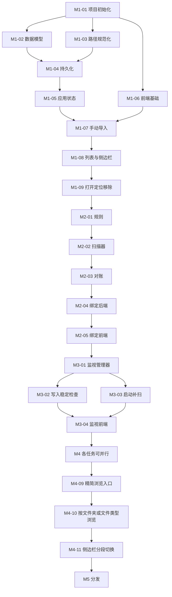

# File Link 开发计划

**对应文档：** `docs/PRD.md` v0.2、`docs/DEV.md` v0.2  
**计划版本：** 0.2  
**日期：** 2026-11-05

本计划把 DEV.md 第 11 节的里程碑拆成模块级任务。后续开发按任务编号推进，每次只做一个任务，做完、测完、更新进度后再进入下一个。

---

## 1. 使用方式

### 1.1 任务编号与规模

- 编号格式：`M<里程碑>-<序号>`，例如 `M2-03`。
- 规模：`S` 半天以内，`M` 约一天，`L` 两天左右。规模超过 `L` 的任务应先拆分再开发。

### 1.2 每个任务的开发流程

1. 在第 2 节进度表确认该任务的依赖都已完成。
2. 阅读任务中「参考」列出的 DEV.md 章节。
3. 只修改任务「文件」中列出的文件；确需改动其他文件时，在提交说明里写明原因。
4. 按「完成标准」写测试并通过。
5. 运行检查：`cargo fmt --check`、`cargo clippy -- -D warnings`、`cargo test`；涉及前端时再运行 `pnpm lint` 和 `pnpm vitest run`。
6. 在第 2 节进度表中把该任务勾选为完成。
7. 提交，提交说明采用 Conventional Commits：以 `feat` / `fix` / `docs` / `refactor` / `test` / `chore` 开头，例如 `feat: 实现对账算法`。不要写任务编号。

### 1.3 完成定义

一个任务只有同时满足以下条件才算完成：

- 「完成标准」中的每一项都已验证。
- 第 1.2 节第 5 步的检查全部通过。
- 没有遗留 `todo!()`、`unimplemented!()` 或注释掉的代码。
- 不包含对原文件的写入、重命名、删除调用（DEV.md 第 13 节）。

### 1.4 变更规则

- 开发中发现 DEV.md 的设计行不通或需要调整时，先修改 DEV.md，再改代码。
- 需要新增任务时，在对应里程碑末尾追加编号，不重排已有编号。
- 里程碑之间严格按顺序推进：上一个里程碑验收通过后，才开始下一个里程碑。

---

## 2. 进度总表

### M1 骨架

- [x] M1-01 项目初始化 `M`
- [x] M1-02 数据模型与错误类型 `S`
- [x] M1-03 路径规范化 `S`
- [x] M1-04 数据持久化 `M`
- [x] M1-05 应用状态与快照接口 `M`
- [x] M1-06 前端基础：类型、接口封装、状态 `S`
- [x] M1-07 手动导入 `M`
- [x] M1-08 链接列表与侧边栏 `M`
- [x] M1-09 打开、定位、移除 `M`
- [x] M1-10 M1 验收

### M2 绑定

- [x] M2-01 规则 `S`
- [x] M2-02 扫描器 `M`
- [x] M2-03 对账算法 `L`
- [x] M2-04 绑定相关后端接口 `L`
- [x] M2-05 绑定相关前端界面 `L`
- [x] M2-06 M2 验收

### M3 监视

- [x] M3-01 监视管理器 `L`
- [x] M3-02 写入稳定检查 `M`
- [x] M3-03 启动补扫与目录不可用处理 `M`
- [x] M3-04 监视相关前端界面 `M`
- [x] M3-05 M3 验收

### M4 打磨（完成后发布 0.1.0 免安装版）

- [x] M4-01 搜索与排序 `S`
- [x] M4-02 文件类型设置 `M`
- [x] M4-03 多选、批量操作与键盘操作 `M`
- [x] M4-04 长列表虚拟滚动 `S`
- [x] M4-05 文案与错误提示走查 `S`
- [x] M4-06 日志 `S`
- [x] M4-07 图标与 release 构建 `M`
- [x] M4-08 M4 验收与 0.1.0 发布
- [x] M4-09 精简浏览入口 `M`
- [x] M4-10 按文件夹或文件类型浏览 `S`
- [x] M4-11 侧边栏分段切换 `S`

### M5 分发（MVP 之后）

- [ ] M5-01 NSIS 安装程序 `M`
- [ ] M5-02 代码签名 `S`
- [ ] M5-03 M5 验收

---

## 3. 任务依赖

M4-01 到 M4-07 之间没有依赖，可以按任意顺序完成，但 M4-08 必须在它们之后。M4-09、M4-10、M4-11 是 0.1.0 发布后的产品精简，完成后才开始 M5。

---

## 4. M1 骨架

**目标：** 能手动导入 HTML 文件，在列表中看到、打开、定位、移除。  
**里程碑验收：** DEV.md 第 10.4 节第 1、4、5 项。

### M1-01 项目初始化 `M`

- **依赖：** 无
- **参考：** DEV.md 第 1、2、3 节，第 12.3 节，第 13 节
- **文件：** 项目根目录全部脚手架文件、`src-tauri/Cargo.toml`、`src-tauri/tauri.conf.json`、`src-tauri/capabilities/default.json`、`src-tauri/src/lib.rs`、`src-tauri/src/main.rs`、`.gitignore`
- **内容：**
  - `git init`，`.gitignore` 忽略 `node_modules/`、`dist/`、`src-tauri/target/`。
  - 用 `pnpm create tauri-app@latest` 生成 React + TypeScript 项目到当前目录（保留 `docs/`）。
  - `Cargo.toml` 包名 `file-link`；`tauri.conf.json` 设置 `productName`、`identifier`、窗口标题、`version = 0.1.0`，`bundle.active = false`。
  - 注册插件：dialog、opener、single-instance（第二个实例激活已有窗口）。
  - `capabilities/default.json` 只开放 DEV.md 第 13 节列出的权限。
  - 按 DEV.md 第 3 节建立空的目录和模块文件（`core/mod.rs` 等），保证能编译。
  - 前端配置 TS `strict`、eslint、prettier；`package.json` 增加 `lint`、`format` 脚本。
  - 删除模板自带的示例 command 和示例页面。
- **完成标准：**
  - `pnpm tauri dev` 打开一个标题为 `File Link` 的空窗口。
  - 再次运行 `pnpm tauri dev` 产生的第二个实例不会打开新窗口。
  - `cargo clippy -- -D warnings` 和 `pnpm lint` 通过。

### M1-02 数据模型与错误类型 `S`

- **依赖：** M1-01
- **参考：** DEV.md 第 5.1 节、第 7.3 节
- **文件：** `src-tauri/src/core/model.rs`、`src-tauri/src/error.rs`
- **内容：**
  - 实现 `Data`、`Settings`、`Binding`、`Link`、`Source`、`Ignore`。
  - `Data::default()`：`version = 1`，扩展名 `[".html", ".htm"]`，其余为空。
  - `Link` 上的辅助方法：`has_source`、`add_source`、`remove_binding_source`。
  - 实现 `AppError`，序列化为 `{ code, message }`。
- **完成标准（单元测试）：**
  - `Data` 序列化后字段为 camelCase，`Source` 序列化为 `{ "type": "manual" }` 和 `{ "type": "binding", "bindingId": "..." }`。
  - 序列化再反序列化后数据不变。
  - 缺少 `missing`、`unavailable` 字段的旧 JSON 能正常读取。
  - `add_source` 不产生重复来源。
  - `AppError::FileMissing` 序列化结果为 `{ "code": "FileMissing", "message": "文件不存在或已被移动" }`。

### M1-03 路径规范化 `S`

- **依赖：** M1-01
- **参考：** DEV.md 第 6.1 节
- **文件：** `src-tauri/src/core/path.rs`
- **内容：** 实现 `normalize(path) -> Result<(display, key)>`。
- **完成标准（单元测试，使用临时目录）：**
  - 大小写不同、`/` 与 `\` 混用、末尾带分隔符的同一路径得到相同 `key`。
  - 结果不带 `\\?\` 前缀。
  - 相对路径被转换为绝对路径。
  - 不存在的路径返回错误。

### M1-04 数据持久化 `M`

- **依赖：** M1-02、M1-03
- **参考：** DEV.md 第 5.4 节
- **文件：** `src-tauri/src/core/store.rs`
- **内容：**
  - `load(path) -> LoadResult`：文件不存在返回默认数据；解析失败时把原文件重命名为 `data.json.broken-<时间戳>`，返回默认数据和备份路径。
  - `save(path, data)`：写 `.tmp`、`sync_all`、`rename` 覆盖。
  - `migrate(data)`：按 `version` 逐级迁移，目前只有版本 1，留出结构。
- **完成标准（单元测试）：**
  - 保存后再读取，数据一致。
  - 保存完成后目录中没有残留的 `.tmp` 文件。
  - 写入损坏的 JSON 后读取：返回默认数据，生成 `.broken-` 备份文件，备份内容与原文件一致。
  - 目标目录不存在时 `save` 能自动创建目录。

### M1-05 应用状态与快照接口 `M`

- **依赖：** M1-04
- **参考：** DEV.md 第 6.7 节、第 7.1 节、第 7.2 节、第 8.1 节
- **文件：** `src-tauri/src/service.rs`、`src-tauri/src/commands.rs`、`src-tauri/src/lib.rs`
- **内容：**
  - `AppState { data: Mutex<Data>, data_path }`（`watcher` 字段在 M3-01 加入）。
  - 启动时用 `app_data_dir()` 定位 `data.json` 并加载，`app.manage()` 注册状态。
  - 加载时发生了损坏恢复，则在前端就绪后发送 `data-recovered` 事件。
  - service 提供统一的写操作封装：加锁 → 修改 → 保存 → 解锁 → 发送 `state-changed`。后续所有写操作都通过它完成。
  - command：`get_snapshot`。
- **完成标准：**
  - 首次启动后 `%APPDATA%\com.filelink.app\data.json` 被创建，内容为默认数据。
  - 前端开发者工具中调用 `invoke("get_snapshot")` 能拿到快照。
  - service 的写操作封装有单元测试：修改后文件内容已更新。

### M1-06 前端基础：类型、接口封装、状态 `S`

- **依赖：** M1-01
- **参考：** DEV.md 第 5.5 节、第 7 节、第 9.2 节
- **文件：** `src/types.ts`、`src/api/commands.ts`、`src/api/events.ts`、`src/store.ts`
- **内容：**
  - `types.ts` 按 DEV.md 第 5.5 节定义类型，增加 `AppError` 类型。
  - `commands.ts` 为 DEV.md 第 7.1 节的每个 command 写一个类型化函数（尚未实现的后端 command 先写好函数签名）。
  - `events.ts` 封装第 7.2 节的事件订阅。
  - `store.ts`：Zustand store，包含 `snapshot`、`view`、`query`、`selectedIds` 和 `refresh()`。
  - `App.tsx` 启动时调用 `refresh()`，并订阅 `state-changed` 后自动 `refresh()`。
- **完成标准：**
  - `pnpm tsc --noEmit` 通过。
  - 运行后 store 中能拿到快照。
  - 组件代码中不直接调用 `invoke`，只通过 `api/` 访问后端。

### M1-07 手动导入 `M`

- **依赖：** M1-05、M1-06
- **参考：** DEV.md 第 6.1 节、第 8.2 节
- **文件：** `src-tauri/src/service.rs`、`src-tauri/src/commands.rs`、`src/components/Toolbar.tsx`、`src/components/Toast.tsx`
- **内容：**
  - 后端 `import_files(paths)`：逐个规范化；已存在则补 `Manual` 来源并计入 `skipped`，否则新建 link；路径无效的计入 `skipped` 并记日志。
  - 前端工具栏「导入文件」按钮：打开多选文件框，过滤器为当前扩展名列表，另附「所有文件」。
  - Toast 组件，显示「已导入 N 个，跳过 M 个已存在」。
- **完成标准：**
  - 单元测试：重复导入同一文件只产生一条 link；大小写不同的同一路径视为同一文件。
  - 手动测试：导入 3 个 HTML 后，`data.json` 中出现 3 条 link，来源为手动。

### M1-08 链接列表与侧边栏 `M`

- **依赖：** M1-07
- **参考：** DEV.md 第 9.1 节、第 9.2 节
- **文件：** `src/components/Sidebar.tsx`、`src/components/LinkList.tsx`、`src/components/LinkRow.tsx`、`src/utils/filter.ts`、`src/styles/`
- **内容：**
  - 整体布局：左侧侧边栏，右侧工具栏加列表。
  - 侧边栏显示「全部链接」「手动导入」及数量；「文件夹」分组先留空。
  - 列表列：名称、路径、来源、加入时间；缺失的 link 灰显并带「缺失」标签。
  - `filter.ts` 中实现按视图过滤（搜索和排序在 M4-01 实现）。
- **完成标准：**
  - 切换「全部链接」「手动导入」时列表内容正确。
  - 导入新文件后列表自动刷新，无需手动操作。
  - `filter.ts` 有 vitest 测试覆盖两种视图。

### M1-09 打开、定位、移除 `M`

- **依赖：** M1-08
- **参考：** DEV.md 第 5.3 节、第 6.6 节、第 8.5 节、第 9.3 节
- **文件：** `src-tauri/src/service.rs`、`src-tauri/src/commands.rs`、`src/components/LinkRow.tsx`、`src/components/ConfirmDialog.tsx`
- **内容：**
  - 后端 `open_link`、`reveal_link`，按 DEV.md 第 6.6 节处理缺失和失败。
  - 后端 `remove_links`：带绑定来源的写入忽略名单，然后删除 link（M1 阶段还没有绑定，但逻辑要一次写完整）。
  - 前端：双击行打开；右键菜单「打开」「在资源管理器中显示」「复制路径」「移除链接」。
  - 确认框使用 DEV.md 第 8.5 节的文案。
  - 后端返回错误时用 Toast 显示 `message`。
- **完成标准：**
  - 单元测试：`remove_links` 对手动 link 不写忽略名单；对带绑定来源的 link 每个绑定写一条忽略记录。
  - 手动测试：HTML 在默认浏览器打开；资源管理器中选中了该文件；在磁盘上删掉文件后点打开，提示「文件不存在或已被移动」，该行变为缺失；移除后原文件仍在。

### M1-10 M1 验收

- 在 `pnpm tauri dev` 下完成 DEV.md 第 10.4 节第 1、4、5 项。
- 第 2 节 M1 全部勾选后，进入 M2。

---

## 5. M2 绑定

**目标：** 能绑定文件夹，按规则生成链接，手动扫描新文件，解除绑定。  
**里程碑验收：** DEV.md 第 10.4 节第 2、6 项，以及第 3 项中「关闭自动导入后手动扫描」的部分。

### M2-01 规则 `S`

- **依赖：** M1-09
- **参考：** DEV.md 第 6.2 节
- **文件：** `src-tauri/src/core/rule.rs`
- **内容：** `Rule` 结构、`effective_rule(binding, settings)`、`matches`、`is_temp_file`、`is_skipped_dir`。
- **完成标准（单元测试）：**
  - `.HTML`、`.Htm` 匹配默认规则；`.html.bak` 不匹配。
  - `~$a.html`、`a.html.crdownload`、`a.tmp` 判定为临时文件。
  - `node_modules`、`.git`（任意大小写）被跳过。

### M2-02 扫描器 `M`

- **依赖：** M2-01
- **参考：** DEV.md 第 6.3 节
- **文件：** `src-tauri/src/core/scanner.rs`
- **内容：** `scan(path, recursive, rule) -> Result<Vec<(display, key)>>`，非递归读一层，递归用 `walkdir` 并跳过内置忽略目录和临时文件。
- **完成标准（单元测试，临时目录）：**
  - 非递归时不返回子目录中的文件；递归时返回。
  - `node_modules` 内的 HTML 不被返回。
  - 绑定目录不存在时返回错误。
  - 返回结果中没有重复的 `key`。

### M2-03 对账算法 `L`

- **依赖：** M2-02
- **参考：** DEV.md 第 5.2 节、第 5.3 节、第 6.4 节
- **文件：** `src-tauri/src/core/reconcile.rs`
- **内容：**
  - `reconcile(data, binding_id, files) -> ReconcileSummary`，算法见 DEV.md 第 6.4 节。
  - `refresh_missing(data) -> usize`：全量状态检查。
  - `unbind(data, binding_id) -> usize`：去掉绑定来源、删除空来源 link、清除该绑定的忽略记录，返回删除的 link 数。
  - 文件存在性检查通过参数注入（例如传入 `exists: impl Fn(&str) -> bool`），便于测试。
- **完成标准（单元测试）：**
  - 新文件被添加；再次对账不重复添加。
  - 被忽略的文件不会被添加。
  - 文件不在扫描结果中且不存在时标记缺失；重新出现时取消缺失并计入 `restored`。
  - 文件仍存在但不在扫描结果中（规则改变）时，link 保留且不标记缺失。
  - 手动 link 与绑定扫描到同一文件时，合并为一条 link，带两个来源。
  - `unbind` 后：仅有绑定来源的 link 被删除；同时有手动来源的 link 保留且只剩手动来源；该绑定的忽略记录被清除。
  - `refresh_missing` 能正确更新手动 link 的缺失状态。

### M2-04 绑定相关后端接口 `L`

- **依赖：** M2-03
- **参考：** DEV.md 第 6.7 节、第 7.1 节、第 8.3 节、第 8.6 节
- **文件：** `src-tauri/src/service.rs`、`src-tauri/src/commands.rs`
- **内容：**
  - `preview_binding`、`add_binding`、`update_binding`（本阶段只处理 `recursive`，`autoWatch` 只保存不生效）、`remove_binding`、`scan_binding`、`scan_all`。
  - 扫描在锁外执行，拿到结果后再加锁对账（DEV.md 第 6.7 节）。
  - `add_binding` 时目录已绑定返回 `BindingExists`；目录不可用返回 `BindingUnavailable`。
  - `scan_all` = 对每个绑定对账 + `refresh_missing`；某个绑定不可用时置 `unavailable = true` 并继续处理其他绑定。
- **完成标准：**
  - 单元测试覆盖：重复绑定报错；绑定子目录开关切换后对账结果变化；`scan_all` 中一个绑定目录不存在不影响其他绑定。
  - 前端开发者工具中依次调用这些 command，`data.json` 内容符合预期。

### M2-05 绑定相关前端界面 `L`

- **依赖：** M2-04
- **参考：** DEV.md 第 8.3 节、第 8.6 节、第 9.1 节
- **文件：** `src/components/Toolbar.tsx`、`src/components/Sidebar.tsx`、`src/components/BindDialog.tsx`（新增）、`src/components/LinkRow.tsx`、`src/utils/filter.ts`
- **内容：**
  - 工具栏「绑定文件夹」：选择文件夹 → 绑定选项对话框（包含子文件夹、自动导入，默认值见 DEV.md 第 14 节）→ 预扫描 → 超过 500 个时二次确认 → 绑定。
  - 工具栏「扫描新文件」：调用 `scan_all`，Toast 显示新增、恢复、缺失数量。
  - 侧边栏「文件夹」分组：显示各绑定名称和数量，悬停显示完整路径；右键菜单「扫描」「包含子文件夹」开关、「在资源管理器中打开」「解除绑定」（自动导入开关在 M3-04 加入）。
  - 解除绑定确认框使用 DEV.md 第 8.6 节的文案。
  - 列表「来源」列按 DEV.md 第 5.2 节显示。
  - `filter.ts` 增加按绑定过滤的视图。
- **完成标准：**
  - 手动测试：绑定含 5 个 HTML 的文件夹，侧边栏出现该文件夹且数量为 5；往里复制新 HTML 后点「扫描新文件」，数量变为 6；解除绑定后这些 link 消失，手动导入过的同名文件仍在。
  - vitest：按绑定过滤的视图测试通过。

### M2-06 M2 验收

- 在 `pnpm tauri dev` 下完成 DEV.md 第 10.4 节第 2、6 项，以及第 3 项中手动扫描的部分。
- 回归 M1 的验收项。

---

## 6. M3 监视

**目标：** 绑定目录中出现新文件时自动导入；程序未运行期间的变化在启动时补齐；文件删除后显示缺失。  
**里程碑验收：** DEV.md 第 10.4 节第 3、7 项。

### M3-01 监视管理器 `L`

- **依赖：** M2-05
- **参考：** DEV.md 第 6.5 节
- **文件：** `src-tauri/src/watcher.rs`、`src-tauri/src/service.rs`、`src-tauri/src/lib.rs`
- **内容：**
  - `WatcherManager`：`start(binding)`、`stop(binding_id)`、`restart(binding)`。
  - 每个开启自动导入的绑定一个 debouncer，防抖 1500ms；事件只发送 `binding_id` 到通道。
  - 后台工作线程合并 500ms 内同一绑定的请求，然后调用 `service.reconcile_binding(id)`；有新增时发送 `auto-imported` 事件。
  - 监视出错时触发该绑定的完整对账。
  - `AppState` 加入 `watcher` 字段；`add_binding`、`update_binding`、`remove_binding` 同步启停监视（此时 `autoWatch` 开关开始生效）。
- **完成标准：**
  - 集成测试（`#[ignore]`）：开启监视后在临时目录创建 HTML，约 3 秒内出现新 link。
  - 关闭某个绑定的自动导入后，往该目录复制文件不会自动导入。
  - 解除绑定后该目录不再被监视（日志中可见 debouncer 已停止）。

### M3-02 写入稳定检查 `M`

- **依赖：** M3-01
- **参考：** DEV.md 第 6.5 节「写入中的文件」
- **文件：** `src-tauri/src/service.rs`、`src-tauri/src/watcher.rs`
- **内容：**
  - 自动对账发现新文件时，间隔 500ms 两次读取大小与修改时间；不一致的文件本次不建 link，并在 2 秒后为该绑定重新排一次对账。
  - 手动扫描不做稳定检查（用户主动触发，避免等待）。
- **完成标准：**
  - 集成测试（`#[ignore]`）：持续写入一个大文件期间不生成 link，写完后自动生成。
  - 浏览器下载 HTML 到绑定目录时，只生成最终文件的 link，不生成 `.crdownload` 的 link。

### M3-03 启动补扫与目录不可用处理 `M`

- **依赖：** M3-01
- **参考：** DEV.md 第 8.1 节、第 6.5 节「监视出错」
- **文件：** `src-tauri/src/service.rs`、`src-tauri/src/lib.rs`
- **内容：**
  - 启动流程：加载数据 → 后台对每个绑定对账 → `refresh_missing` → 为开启自动导入的绑定启动监视。补扫不阻塞窗口显示。
  - 绑定目录不存在或不可读：置 `unavailable = true`，停止其监视，发送 `binding-unavailable` 事件；之后扫描发现目录恢复时，置回 `false` 并在需要时重新启动监视。
- **完成标准：**
  - 关闭程序 → 往绑定目录添加 2 个 HTML、删除 1 个已收录的 HTML → 启动程序：新增 2 条 link，1 条显示缺失。
  - 重命名绑定目录后启动：该绑定标记为不可用，程序正常运行；改回原名后点「扫描新文件」，绑定恢复。

### M3-04 监视相关前端界面 `M`

- **依赖：** M3-02、M3-03
- **参考：** DEV.md 第 6.5 节、第 7.2 节、第 9.1 节
- **文件：** `src/components/Sidebar.tsx`、`src/components/Toast.tsx`、`src/api/events.ts`、`src/App.tsx`
- **内容：**
  - 订阅 `auto-imported`，Toast 显示「已从 xxx 自动导入 N 个文件」。
  - 订阅 `binding-unavailable`，侧边栏该绑定显示「目录不可用」。
  - 侧边栏绑定右键菜单加入「自动导入」开关。
  - 绑定路径为网络路径且开启自动导入时，显示 DEV.md 第 6.5 节的提示。
- **完成标准：** 手动测试上述四项界面行为均正确。

### M3-05 M3 验收

- 在 `pnpm tauri dev` 下完成 DEV.md 第 10.4 节第 3、7 项。
- 回归 M1、M2 的验收项。

---

## 7. M4 打磨

**目标：** 补齐体验细节，产出可分发的 0.1.0 免安装版。  
**里程碑验收：** DEV.md 第 10.4 节全部项目在 release 构建上通过，以及第 12.8 节第 1–4、6 项。

### M4-01 搜索与排序 `S`

- **依赖：** M3-05
- **参考：** DEV.md 第 9.2 节
- **文件：** `src/utils/filter.ts`、`src/components/Toolbar.tsx`
- **内容：** 搜索框；按名称和路径做不区分大小写的子串匹配；缺失的排在后面，其余按名称排序。
- **完成标准：** vitest 覆盖搜索与排序；输入时列表实时过滤，切换视图时保留搜索词。

### M4-02 文件类型设置 `M`

- **依赖：** M3-05
- **参考：** DEV.md 第 7.1 节 `update_settings`、第 9.1 节
- **文件：** `src-tauri/src/service.rs`、`src-tauri/src/commands.rs`、`src/components/SettingsDialog.tsx`、`src/components/Toolbar.tsx`
- **内容：**
  - 后端 `update_settings`：去空格、转小写、补前导点、去重；列表为空时报错。
  - 前端设置对话框，保存时提示「新规则将在之后的扫描中生效」。
- **完成标准：**
  - 单元测试：输入 `HTML, .htm ,md` 被规范化为 `[".html", ".htm", ".md"]`；空列表被拒绝。
  - 手动测试：加入 `.md` 后扫描，绑定目录中的 md 文件出现；已有 HTML link 不受影响。

### M4-03 多选、批量操作与键盘操作 `M`

- **依赖：** M3-05
- **参考：** DEV.md 第 9.1 节
- **文件：** `src/components/LinkList.tsx`、`src/components/LinkRow.tsx`、`src/store.ts`
- **内容：** Ctrl / Shift 多选；批量移除（确认框显示数量）；回车打开选中项；Delete 键触发移除确认。
- **完成标准：** 手动测试多选和批量移除；批量移除后原文件都在。

### M4-04 长列表虚拟滚动 `S`

- **依赖：** M3-05
- **参考：** DEV.md 第 1 节
- **文件：** `src/components/LinkList.tsx`
- **内容：** 用 `@tanstack/react-virtual` 改造列表。
- **完成标准：** 绑定一个含 2000 个 HTML 的测试目录，滚动流畅，搜索输入无明显卡顿。

### M4-05 文案与错误提示走查 `S`

- **依赖：** M3-05
- **参考：** DEV.md 第 7.3 节、第 9.3 节
- **文件：** 涉及文案的前端组件、`src-tauri/src/error.rs`
- **内容：**
  - 逐一检查所有删除类确认框都写明「只删除链接，不删除原文件」。
  - 检查所有错误提示都说明原因和可做的操作。
  - 订阅 `data-recovered`，提示数据文件损坏并显示备份位置。
- **完成标准：** 按 DEV.md 第 8 节每个流程走一遍，没有英文文案、没有未处理的错误（控制台无未捕获异常）。

### M4-06 日志 `S`

- **依赖：** M3-05
- **参考：** DEV.md 第 1.1 节
- **文件：** `src-tauri/src/lib.rs`、`src-tauri/Cargo.toml`
- **内容：** 接入 `tauri-plugin-log`，release 构建日志写入应用日志目录，级别 `info`；扫描、对账、监视启停、错误都有日志。
- **完成标准：** release 构建运行后能找到日志文件，并能从日志中看出一次自动导入的完整过程。

### M4-07 图标与 release 构建 `M`

- **依赖：** M3-05
- **参考：** DEV.md 第 12.3 节、第 12.4 节
- **文件：** `src-tauri/icons/`、`src-tauri/Cargo.toml`、`src-tauri/tauri.conf.json`
- **内容：** 准备 1024×1024 源图并生成图标；配置 release profile；构建免安装版 exe。
- **完成标准：** `pnpm tauri build` 成功；exe 显示自定义图标；运行时没有控制台窗口；体积在 15 MB 以内。

### M4-08 M4 验收与 0.1.0 发布

- 在 release 构建上完成 DEV.md 第 10.4 节全部项目。
- 按 DEV.md 第 12.8 节第 1–4、6 项完成发布检查，产出 `FileLink_0.1.0_x64_portable.exe` 和 SHA256 校验值。
- 打 Git 标签 `v0.1.0`。

### M4-09 精简浏览入口 `M`

- **依赖：** M4-08
- **参考：** DEV.md 第 8.2 节、第 9.1 节、第 9.2 节
- **文件：** `docs/PRD.md`、`docs/DEV.md`、`docs/PLAN.md`、`CHANGELOG.md`、`src/types.ts`、`src/store.ts`、`src/utils/filter.ts`、`src/utils/filter.test.ts`、`src/components/Sidebar.tsx`、`src/components/Toolbar.tsx`、`src/components/LinkList.tsx`、`src/components/BindDialog.tsx`
- **内容：**
  - 侧边栏去掉「全部链接」「手动导入」，只保留绑定文件夹。
  - 工具栏去掉搜索框和「导入文件」。
  - 列表只显示当前选中绑定的链接；无绑定时提示绑定文件夹。
  - 绑定成功后切到该文件夹；当前绑定被解除或失效后切到剩余第一个，否则为空。
- **完成标准：**
  - 侧边栏没有「全部链接」「手动导入」；工具栏没有搜索框和「导入文件」。
  - 切换文件夹时列表只显示该绑定的链接；仅手动来源的链接不出现。
  - vitest 覆盖绑定视图过滤与排序，不再覆盖搜索 / 全部 / 手动视图。

### M4-10 按文件夹或文件类型浏览 `S`

- **依赖：** M4-09
- **参考：** DEV.md 第 9.1 节、第 9.2 节
- **文件：** `docs/PRD.md`、`docs/DEV.md`、`docs/PLAN.md`、`CHANGELOG.md`、`src/types.ts`、`src/store.ts`、`src/utils/filter.ts`、`src/utils/filter.test.ts`、`src/components/Sidebar.tsx`、`src/components/LinkList.tsx`
- **内容：**
  - 侧边栏分「文件夹」「文件类型」两组。
  - 文件夹仍是绑定目录；文件类型按已绑定链接的扩展名汇总。
  - 选中某一类型时，列表只显示该扩展名且来自绑定的链接。
- **完成标准：**
  - 可在文件夹与文件类型之间切换，列表内容与当前分类一致。
  - 仅手动来源的链接不出现在任一分类中。
  - vitest 覆盖文件夹视图与文件类型视图。

### M4-11 侧边栏分段切换 `S`

- **依赖：** M4-10
- **参考：** DEV.md 第 9.1 节、第 9.2 节
- **文件：** `docs/PRD.md`、`docs/DEV.md`、`docs/PLAN.md`、`CHANGELOG.md`、`src/store.ts`、`src/store.test.ts`、`src/components/Sidebar.tsx`、`src/styles/app.css`
- **内容：**
  - 侧边栏顶部改为「文件夹 / 类型」分段控件。
  - 同一时间只显示当前分段下的列表：文件夹为绑定目录，类型为已绑定链接的扩展名。
- **完成标准：**
  - 点「文件夹」只看到绑定目录；点「类型」只看到扩展名。
  - 切换后列表与当前分类一致；再次切回时尽量回到上次选中的项。
  - vitest 覆盖分段切换时的视图解析。

---

## 8. M5 分发（MVP 之后）

**目标：** 提供安装版，并消除 SmartScreen 警告。  
**里程碑验收：** DEV.md 第 12.8 节全部项目。

### M5-01 NSIS 安装程序 `M`

- **依赖：** M4-11
- **参考：** DEV.md 第 12.2 节、第 12.3 节、第 12.6 节
- **文件：** `src-tauri/tauri.conf.json`
- **内容：** `bundle.active = true`，配置 NSIS（当前用户安装、简体中文）与 `embedBootstrapper`。
- **完成标准：** 在一台干净的 Windows 10 上安装、启动、卸载均正常；卸载时不勾选「删除应用数据」则链接数据保留；被管理的原文件始终不受影响。

### M5-02 代码签名 `S`

- **依赖：** M5-01，且已取得代码签名证书
- **参考：** DEV.md 第 12.5 节
- **文件：** `src-tauri/tauri.conf.json`
- **内容：** 配置 `certificateThumbprint`、`digestAlgorithm`、`timestampUrl`。
- **完成标准：** exe 和安装程序的文件属性中能看到有效的数字签名。

### M5-03 M5 验收

- 按 DEV.md 第 12.8 节全部项目完成发布检查。

---

## 9. 风险与应对

| 风险                                       | 影响的任务   | 应对                                                                  |
| ------------------------------------------ | ------------ | --------------------------------------------------------------------- |
| Windows 目录监视丢事件或事件顺序混乱       | M3-01        | 设计上已只把事件当作对账信号；集成测试中加入批量复制 100 个文件的场景 |
| 大目录首次扫描慢，阻塞界面                 | M2-04        | 扫描在锁外、后台线程执行；预扫描超过 500 个时二次确认                 |
| `tauri-plugin-opener` 的定位接口与预期不符 | M1-09        | 退路：用 `std::process::Command` 执行 `explorer /select,<路径>`       |
| 路径中有特殊字符或超长路径                 | M1-03、M2-02 | 测试中加入中文、空格、超过 260 字符的路径用例                         |
| 免安装版在没有 WebView2 的机器上无法启动   | M4-07        | 发布说明写明依赖；M5 安装版自动补装                                   |
